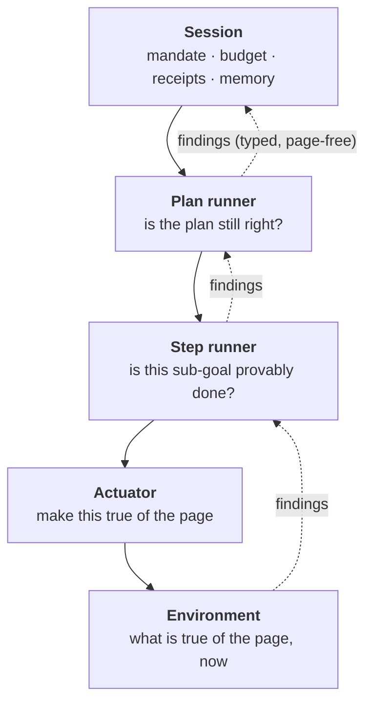

# Step 9: rethinking the control architecture

**Status:** phases 1 and 2 built, 2026-10-10. Phases 0, 3-5 proposed. Written after five days of live testing produced twenty-three fixes and one uncomfortable pattern.

- **Phase 1 - the environment contract.** `browser/affordances.py` answers *what does this element take?* where the page is. `Observer.observe()` now promises a **settled** page, or flags `rendering`; the three ad-hoc waits bolted onto the agent loop are deleted.
- **Phase 2 - intents.** `fill`, `choose`, `open`, `press` join the action vocabulary, and the controller picks the gesture from the affordance rather than from the verb. **Naming the wrong verb now costs nothing.**

The security architecture — mandates, planner isolation, evidence, receipts — is doing its job and is externally corroborated. What needs rethinking is everything *around* it: how the agent perceives a page, how it acts on one, and how what it learns while running reaches the decisions that matter.

## The smell

`_execute_subgoal` is one `while` loop with seventeen labelled concerns in it:

```
OBSERVE · GIVE A SLOW PAGE ITS MOMENT · WHAT DID THE LAST ACTION DO? ·
EVIDENCE THAT POINTS AT A PAGE THAT ISN'T THERE · A PAGE WITH NOTHING ON IT ·
ALREADY PROVEN? · LOGIN DETECTION · THINK · MCP TOOL CALL · TERMINAL: done ·
ELEMENT ID VALIDATION · A URL THAT ALREADY LED NOWHERE · NOTHING TO ENTER ·
MANDATE CHECK · SAFETY CHECK · ACT · STUCK DETECTION
```

Six of those were added in the last five days, one per live failure. Each is defensible on its own. Together they say something is wrong: **the only way to express a new piece of knowledge about the world is to add a branch to the loop.**

## What the evidence actually says

Twenty-three fixes, grouped by the concept each one needed. The groups are the architecture the code doesn't have.

| The concept that was missing | Fixes that had to work around it |
|---|---|
| **A settled page.** "Is this page finished rendering?" | A slow site was called dead; the same wait now appears in three places; values were read off a blank page; an action's outcome was judged before its navigation committed |
| **An affordance.** "What does this element take, and which verb commits it?" | `select` on a combobox; one-shot insert for inline autocomplete; commit-on-type (tried and reverted); a dialog's Done; refusing a `type` with no text; the executor still picking the wrong verb on Google Flights |
| **A fact learned mid-run.** "This URL is dead. This field needs choosing." | Dead-URL refusal; dropping evidence that names a missing page; the action-outcome trail; block-report deduplication |
| **Proof reachability.** "Can this check ever pass?" | 404s passing url checks; text checks that can't see field values; dates the site rewrites; a value-read check that proved a search had run |
| **Progress.** "Is this attempt getting anywhere?" | Early-stop when proven; empty-page give-up; replan retry; stuck detection by repeated action |
| **Who owns a contract.** "Whose value spec wins?" | The caller's spec being overwritten; positional values |

Six concepts. Twenty-three patches. No new layer.

Two deeper problems sit underneath:

**Feedback is lossy and one-directional.** Execution learns a great deal — this page 404s, this field won't keep a typed value, this check can never pass — and almost none of it reaches the planner, because the only channel is a free-text `failure` string on replan. So a plan built on a wrong assumption can't be corrected, only thrown away and rewritten from scratch.

**One recovery mechanism for three different faults.** A wrong plan (no step picks the year), wrong evidence (a phrase the page never shows), and wrong execution (the verb that doesn't commit) all end in the same replan. Nothing distinguishes them, so nothing can respond appropriately to any of them.

## What stays

Not a rewrite. These are load-bearing and measured:

- **Mandates** enforced in the network layer, checked per redirect hop. Google DeepMind's [CaMeL](https://arxiv.org/pdf/2503.18813) is the same idea — capabilities on data, plus Simon Willison's Dual-LLM split — and 2026 surveys of AgentDojo find system-level defences reach near-zero attack success with little utility cost. We are on the right side of that.
- **Planner isolation.** The canary test stays the hardest rule in the codebase.
- **Evidence and receipts.** The thing that keeps catching *us*: twice this week a run came back "verified" and wrong, and both times the receipt said exactly which check was responsible.
- **Trials.** Every claim in this document is a number from it.

## The proposed shape

Five layers. Each owns one question, promises one thing, and is forbidden from knowing something.



| Layer | Owns | Promises | May not know |
|---|---|---|---|
| **Environment** | The page | Every observation it hands out is **settled** — rendered and quiet — or explicitly flagged `rendering`. Elements come with affordances, not just roles. Knows what the document answered | The task, the plan |
| **Actuator** | Changing the page | An **intent** either commits or says why it didn't. "Committing" is one concept here, not five special cases | Why the intent was wanted |
| **Step runner** | One sub-goal | Terminates for a **named reason**: proven, unreachable, no progress, out of budget. Never on a vibe | Other sub-goals |
| **Plan runner** | The plan | Adapts from findings before it replans. The planner it talks to sees only typed, page-free facts | The page |
| **Session** | The run | Mandate, budget, receipts, memory. What exists today | — |

### Intents, not keystrokes

The actuator's vocabulary stops being `type`/`select`/`click` and becomes what you actually want:

```python
Fill(field, value)        # put this value in, however this widget commits
Choose(field, option)     # pick from whatever list it offers
Open(link)                # follow a link the page actually has
Press(control)            # a button
Submit(form)              # with the mandate's write rules in force
```

`Fill` is where typing, inline autocomplete, suggestion lists and a date picker's **Done** all live — one concept, five implementations, chosen from the affordance rather than guessed by a 7B model. That is the Google Flights failure, and it's the same thing [Stagehand's `observe()`](https://docs.stagehand.dev/v3/basics/act) does by returning a *method* alongside each candidate element, and what Playwright MCP does with `browser_fill_form`.

It also kills a whole class of bug: `Fill` can't be issued with nothing to fill, and `Open` can't be issued for a link the page doesn't have.

### Findings: the feedback primitive

The concept all twelve of this week's patches were reaching for. A **finding** is a fact about the world that *code* established during the run:

```python
PageMissing(url, status)          # the browser got a 404, or a blank document
CheckUnreachable(check, because)  # this proof can never pass
ValueNotHere(name, url)           # the value isn't on this page
FieldNeedsChoosing(field)         # typing into it doesn't stick
WriteBlocked(endpoint)            # the mandate refused it
NoProgress(attempts)              # the same state N times
```

Findings flow up, and each carries a **visibility**, the same way values already do:

| Visibility | Reaches | Example |
|---|---|---|
`executor` | the step runner and the executor prompt | `FieldNeedsChoosing` — its label is page text, so it stops here
`planner` | the plan runner and the planner | `PageMissing(url=…)` — the planner wrote that URL itself, so telling it the page is missing adds no page content
`record` | receipts and the run record | all of them

That table is the safety argument, and it's the reason this feedback loop is possible at all: a finding is page-*derived* but not page-*content*. `PageMissing` carries a URL the planner authored and a status code the network measured. Nothing a page wrote crosses the line. Anything that would — a label, a heading, a product name — stays below the planner, exactly as text values already do.

### The five loops, named

Today there is one loop doing all of this implicitly.

| Loop | Runs | Asks | Can decide |
|---|---|---|---|
| **Act** | per action | Did my intent commit? | retry differently, raise a finding |
| **Step** | per observation | Is this sub-goal proven? Am I getting anywhere? | act again, stop proven, stop unreachable, stop stalled |
| **Plan** | per step outcome | Is the plan still right? | continue, **adapt** (drop an impossible check, insert a step), replan |
| **Session** | per run | Am I inside the mandate and the budget? | block, expire, finish |
| **Learning** | across runs | What holds on this site? | memory, plan reuse, trials |

The **adapt** decision in the plan loop is new and is the point. Today a wrong assumption costs a full replan, which starts from nothing. Adaptation is cheap and surgical: drop the check that can't pass, insert the step that's missing, and keep what already worked.

## How we'll know it worked

Predictions, falsifiable with the trials tool:

1. ~~**Google Flights completes its search** in a majority of runs.~~ **Failed** after phases 1 and 2: 0 of 2. The cities now commit — the browser layer stopped being the constraint — and the run is instead held by a planner-written check that nothing can satisfy. See [below](#prediction-1-failed-and-the-reason-is-the-next-phase).
2. **The festival task reads a speaker's name** — it needs one `Choose(year)` the plan never had.
3. **No regression** on the five tasks that work: three lookups, sign-in, GitHub.
4. **The step runner stays under six concerns.** The architectural test: a new live failure should be expressible as a new finding or a new affordance — not a new branch.
5. **Fewer steps per task.** Today's medians carry the cost of guessing; affordances remove the guessing.

## Migration, in shippable pieces

No rewrite, no long-lived branch. Each phase is one commit, measured before the next starts.

| Phase | What | How it's judged |
|---|---|---|
| **0** | ✅ Extract the loop into a `StepRunner` | Done, after 1 and 2. Orchestrator 1,624 → 1,091 lines; 355 tests pass; see below |
| **1** | ✅ Environment contract: settled observations, `rendering`, affordances | Done. Three ad-hoc waits deleted; 355 tests pass |
| **2** | ✅ Actuator intents, the gesture chosen from the affordance | Done. See below |
| **3** | ✅ Findings with visibility; impossible proofs dropped and reported to the planner | Done. Unit-tested; one live shape still to be caught in the act — see below |
| **4** | Progress-based budgets, replacing fixed step caps | Median steps down, no success-rate loss |
| **5** | Findings into memory, so a site's quirks survive the run | Plan reuse finally measurable |

## What phases 1 and 2 actually changed

### The page answers the question now

`takes()` in [`browser/affordances.py`](../../web_lobster/browser/affordances.py) maps what the page says an element *is* onto the gesture that commits a value to it: `open`, `press`, `fill`, `choose`, `toggle`, `confirm`. Checked against every element this week's failures involved:

| Element | Takes |
|---|---|
| Google Flights `Where from?` / `Where to?` (combobox, no form) | `choose` |
| Google Flights `Round trip`, `Economy` | `choose` |
| Wikipedia `Search Wikipedia` (combobox **in a search form**) | `fill` |
| saucedemo `Username`, `Password` | `fill` |
| saucedemo `login-button` (`<input type=submit>`) | `press` |
| A real `<select>` | `choose` |
| A native `date` input | `choose` |
| A dialog's `Done` | `confirm` |

The search-form exception is the load-bearing one. Wikipedia's search box **becomes** `role="combobox"` the moment the controller clicks and clears it, and committing a suggestion there cost the Everest task every run it had been winning. A search box in a form is filled and submitted, because that is what it is for; a city picker keeps nothing until something is chosen.

What can be seen from the page is decided there. What can only be learned by acting — a picker that appears after the first keystroke — stays in the actuator, which presses a dialog's Done when typing opened one.

### A settled page is a promise, not a patch

`Observer.observe()` gives back a page with something on it, waiting up to `browser.settle_seconds` (6 s) for one that has rendered nothing yet, and flagging `rendering=True` if it never does. `Observation.is_empty` replaces a module-level predicate in the orchestrator. Three separate waits — the loop's, the value reader's, and the outcome describer's — were deleted; each had been added after a live run mistook a slow page for a dead one.

### Naming the wrong verb costs nothing

`ActionType` gained `fill`, `choose`, `open`, `press`; `type`, `select` and `click` remain and map onto them. The controller's `_enter()` is now the single place that knows how a value is committed, and it asks the affordance rather than trusting the verb:

```python
if await self._takes(element_id) == Takes.CHOOSE.value or choosing:
    await self._choose(element_id, text)   # type, then take the suggestion or confirm the dialog
else:
    await self._type(element_id, text)     # it keeps what it is given
```

This is the same gesture that was tried once as *make `type` commit everything* and reverted, because it cost Everest 3 of 3. The difference is scope: it now applies to what the page says is a choice, and Wikipedia's search box isn't one. `tests/test_select_action.py` pins both halves — `type` into a combobox commits, `type` into a search box in a form does not.

### What the loop lost

Three waits and one predicate, and — more to the point — the *class* of fix. The next "it picked the wrong verb" bug is a line in `takes()`, not a branch in the loop.

### Prediction 1 failed, and the reason is the next phase

Google Flights after phases 1 and 2: **0 of 2 done**, 18.5 steps median. The prediction in this document — that intents and affordances would get the search to run — was wrong, and the trails say why.

**What phase 2 did do.** Both runs show cities going in and *staying* in:

```
22. type (el=14) "New York" → the field holds it
23. type (el=15) "Tokyo"    → the field holds it
```

That outcome comes from the affordance-aware path: the page said both boxes take a `choose`, so a `type` from the executor committed instead of being thrown away by the next click. Every earlier run on this site lost those values. The widget layer is no longer what fails.

**What fails now.** Both runs spent their whole budget on sub-goal 1, "Clear the 'Where from?' and 'Where to?' fields", whose evidence was:

```
page text contains "Where from?"
page text contains "Where to?"
```

Those strings are the fields' own *labels* — attributes, not page text — and the goal is to **clear** the fields they label. The check cannot pass however well the step goes, so the executor ground away at `triple_click` seventeen times while being told, correctly, that the evidence wasn't met.

This is the same fault as the invented `…/speakers/2026` url check, in a different check type: **the planner writes a proof that nothing could satisfy, and the run is obliged to chase it.** Dropping it needs the thing phase 3 is for — a finding that says *this check is unreachable*, raised where it's discovered and acted on by the plan loop. Two narrower rules fall out of this run too, and belong in `tidy_sub_goals`:

- A text check for an element's own label is unsatisfiable: labels live in attributes, and `inner_text` never sees them.
- A goal whose outcome is *absence* ("clear the field") can't be proven by a text check for the thing being cleared.

**The order the design predicted held up.** Phase 2 was supposed to stop the browser layer being the constraint, and it did — the constraint moved up a layer, to evidence the planner invents. That is phase 3.

### Phase 0, after the fact

Done second, not first, and it was the right order: phases 1 and 2 had already moved the verb question and the page-settling out of the loop, so what got extracted was the loop that remained rather than one that was about to change shape.

[`core/step_runner.py`](../../web_lobster/core/step_runner.py) now owns one sub-goal at a time. The orchestrator went from **1,624 lines to 1,091**, and the runner is 556.

**The move was a move, not a rewrite.** `StepRunner.__getattr__` delegates anything the layer doesn't own back to the orchestrator, so every `self.browser`, `self.state`, `self._verify` in the lifted code kept working untouched. That makes the diff reviewable and the behaviour identical — and it leaves the remaining coupling in plain sight:

| | |
|---|---|
| **Owns** (15) | the loop, `_cheap_checks`, `_describe_outcome`, `_remember_dead`, `_unreachable_checks`, `_mandate_approves`, `_report_violation`, `_enforce_after_action`, `_request_confirmation`, the action trail, and the run-scoped memory of dead URLs, reported blocks and dropped proofs |
| **Borrows** (19) | `browser`, `config`, `state`, `executor`, `safety`, `enforcer`, `mcp`, `ui`, `display`, `context`, `stuck_detector`, `_verify`, `_already_there`, `_render_goal`, `_goal_network_start`, `_proven_by_skip`, `_visited_origins`, `_ui_emit`, `_ui_wait_if_paused` |

Narrowing that second list is what phases 3 to 5 are for. Writing it down is the point: before the split there was no list, because there was no boundary.

**Two real problems the extraction surfaced**, which is the usual argument for doing it at all:

- `_page_fields()` was a one-line wrapper over `browser.field_values()` used by both layers. The split would have duplicated it, so it's gone and both callers ask the browser.
- `collapse_violations()` lived in the orchestrator while operating purely on `Violation`s. It moved to `mandate/enforcer.py`, which also removed the circular import the extraction would otherwise have needed.

**One hazard worth recording.** `__getattr__` intercepts reads, not writes — so the lifted code's `self._goal_start_url = …` landed on the runner while the orchestrator's skip-ahead kept reading its own stale copy. Three tests caught it immediately. Per-goal state that both layers touch is now written explicitly through `self.agent`, with a comment saying why.

### Three tasks, three check types, one cause

The live run after phase 0 made the case for phase 3 by itself. Everest reached the right article in **two steps** — the new machinery working exactly as intended:

```
1. type (el=3) "Mount Everest" → the field holds it
2. click (el=5)                → went to https://en.wikipedia.org/wiki/Mount_Everest
```

and then spent twenty-eight more being told `Missing evidence: page text contains "elevation of Mount Everest is"` — a phrase Wikipedia has never used.

That is the third appearance of one fault:

| Task | The proof the planner invented | Why it can't pass |
|---|---|---|
| Everest | `page text contains "elevation of Mount Everest is"` | The site doesn't phrase it that way |
| Google Flights | `page text contains "Where from?"` | That's a field's label, and the step's job was to clear the field |
| Festival speakers | `page URL matches …/speakers/2026` | The site has no such path |

Three tasks, three check types, one cause: **the planner writes a proof nothing can satisfy, and the run is obliged to chase it to the end of its budget.** Every other layer now does its job and hands the step a page it could finish on. This is the binding constraint, and it is what phase 3 is for.
### Phase 3: findings, and giving up on a proof that can't pass

[`core/findings.py`](../../web_lobster/core/findings.py) is the primitive a dozen earlier fixes were reaching for: a fact *code* established while running, which can travel.

```python
page_missing(url, status)        # the browser got a 404, or a blank document
check_unreachable(check, why)    # this proof can never pass
value_not_here(name, url)        # the value isn't on the page the plan expected
field_needs_choosing(label)      # typing into it doesn't stick
no_progress(attempts)            # the same state, N times over
```

**Visibility is the safety argument, and it is a field on the type.** `page_missing` carries a URL the planner authored and a status code the network measured, so the planner may hear it. `field_needs_choosing` carries a *label* — text a page wrote — so it stops at the executor, exactly as text values already do. `for_planner()` is the one place that filter lives, and adding a finding means deciding, explicitly, who is allowed to hear it. `tests/test_findings.py` pins it: five findings in, four reach the planner, and the one carrying page text is not among them.

Findings now flow into `_describe_failure`, which is what the planner reads when a step fails. Before this, that channel was counts and enum names only — true to the isolation rule, but it meant a plan built on a wrong assumption could never be corrected, only thrown away.

**The rule that catches all three live shapes.** A check is impossible when either:

- it names a URL the browser has proved isn't there, or
- **it has failed three times while the page hasn't changed.**

The second needs no guesses about phrasing, which is why it covers a phrase Wikipedia never uses, a field's own label, and an invented path alike. When it fires, the check is dropped, a finding is recorded, the executor is told to stop trying to satisfy it, and the step finishes on whatever evidence remains — or falls to the validator with its receipt saying it was judged rather than proven. The run record lists every proof given up on, under `problems`.

**What is and isn't demonstrated.** The rule is unit-tested: a step with one satisfiable and one impossible check gives up on the second, finishes on the first, and the finding reaches the planner.

Live, it has not been caught in the act. Six Everest runs today came back **6 of 6 right and verified, median 4 steps and 60 s** — against 0 of 1 in 30 steps the run before, and a historical median of 8 to 9 steps — and **not one of them dropped a proof**, because the planner wrote `url` + `value` checks every time instead of the invented phrase. So:

- The numbers are the best this task has measured, and they are **not** evidence for phase 3.
- The failure phase 3 exists for did not recur in six attempts, having appeared in two of three a week ago. That shift is unexplained; the honest reading is plan variance on a small sample, not a fix.
- Catching the rule firing on a live site is still outstanding. The Google Flights `"Where from?"` check is the reliable way to get it, since that one reproduces.

Claiming the 6 of 6 for this change would be the same mistake as attributing an earlier Everest swing to the wrong fix — which happened in this project, and is why the receipts get read before the explanation.

## What this does not fix

- **The planner is still a 7B model** that under-asks and writes paragraphs for goals. Better structure gives it less room to be wrong; it doesn't make it smarter.
- **Reading a value is still a model call** on page text. Positional reads helped; nothing here addresses the general case.
- **Capability on a site nobody has tried** stays unmeasured until web-lobster runs a public benchmark ([Online-Mind2Web](https://leaderboard.steel.dev/leaderboards/online-mind2web/) is the honest one; expect to score badly on a 7B model and learn something anyway).
- **Prompt injection against a real model**, as opposed to our scripted worst case, is still unmeasured.
